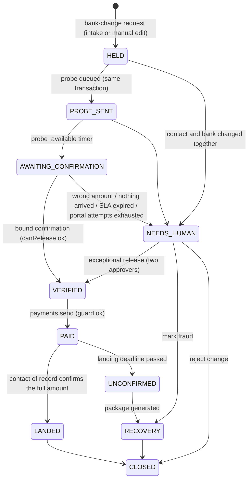

# Landed

**Payment controls for accounts payable: no payment can be sent to a bank account that has not been verified for that specific vendor, even when the AI misses the email.**

Business email compromise works by getting one field changed: a fraudster writes to AP from a compromised or lookalike vendor address saying "we switched banks." The invoice is real, the vendor is real, only the destination changed. Landed holds every new destination, verifies it with a randomized sub-dollar probe deposit that the vendor's **contact of record** (a phone number established at onboarding, never a contact from the request) must read back, and only then lets a payment go out. After payment it confirms the money landed; if it did not, it assembles the bank-recall and FBI IC3 response package.

Built at Cal Hacks 13.0 (Oct 2026) and extended afterwards into a fuller control plane: risk scoring, maker-checker approvals and payment policy, sanctions screening, a public REST API with signed webhooks, Nacha and ISO 20022 payment files, and a controls matrix mapped to SOC 2, NIST CSF and COSO. See `ARCHITECTURE.md` for how the pieces fit and `CHANGELOG.md` for what was added when.

- **Live:** https://landed-blue.vercel.app (demo workspace; simulated bank, clock and vendor answers unless Settings says otherwise)
- **API:** `https://tremendous-malamute-864.convex.site/api/v1/openapi.json`

## What is in the product

| Area | What it does | Where |
|---|---|---|
| **Verification engine** | Holds every bank change, probes the account (11–99¢, Nacha Micro-Entry `ACCTVERIFY`), requires the contact of record to read the amount back on a trusted channel (voice, portal), re-points and holds open invoices, lands the payment, builds the recovery package | `/cases`, `/vendors`, `/mailbox` |
| **Payment boundary** | `payments.send` is the only writer of payments; refuses anything not verified for that vendor; idempotent; fail closed; every refusal is an audit event | `/payment-run` |
| **Risk engine** | Deterministic 0–100 score from 16 signals (lookalike sender, DMARC failure, phone changed with the bank, urgency and secrecy language, ABA checksum, account reused across vendors, …) with the evidence for each | case page, queue, API |
| **Controls** | Email + password sign-in (Convex Auth) with invite-by-email; operators with server-enforced roles resolved from the session; maker-checker approvals; policy evaluated inside the boundary: dual approval above $X, risk review above a score, cooling-off after verification, rolling daily vendor limit, ACH-first for new accounts, block on screening hits | `/controls`, `/approvals` |
| **Sanctions screening** | Jaro-Winkler + token-sort name matching at onboarding and on demand; approver dispositions; OFAC SDN/ALT parsers for production lists (demo list is synthetic) | vendor page, `/controls` |
| **Dashboard and ledger** | Money held and money protected, median time to verify, pipeline, risk tiers, 30-day trend, a cross-module "needs you" queue; payments ledger with landing state and attestation | `/dashboard`, `/payments` |
| **REST API + webhooks** | Scoped keys, idempotent writes, cursor pagination, OpenAPI 3.1; signed webhooks (`Landed-Signature`, HMAC-SHA256) with retries and a built-in signed inbox | `/developers` |
| **Payment files** | Nacha ACH (94-char records, CCD/PPD/CTX, entry hash, blocking) and ISO 20022 pain.001 from payable lines only; full file server-side, masked preview in the browser | `/payment-files` |
| **Compliance** | 20 controls mapped to SOC 2 TSC, NIST CSF 2.0 and COSO with the test that proves each; append-only audit log with a hash chain; CSV export | `/compliance`, `/audit` |
| **Evaluation** | 28 scripted scenarios run twice (extractor on/off) against a real deployment; measured numbers single-sourced into this README | `/eval`, `/judge` |

The two demonstrations that matter most:

1. **AI off, clerk fooled, Pay refused.** Extractor disabled, a clerk types the fraudster's account on the vendor page, clicks Pay. The server mutation refuses: `destination_not_verified`. No AI gets a vote.
2. **Legitimate change passes.** Probe sent, vendor of record states the right amount, account verified, payment sent, landing confirmed. No manual verification.

## Quick start

```bash
cd web && npm ci
npx convex dev            # creates/attaches a dev deployment, writes .env.local
cp .env.example .env.local 2>/dev/null; # or set NEXT_PUBLIC_CONVEX_URL / NEXT_PUBLIC_CONVEX_SITE_URL
node scripts/sync-env.mjs --generate   # ACCOUNT_HMAC_KEY, ACCOUNT_ENC_KEY, EVAL_KEY, SITE_URL and the Convex Auth JWT keys
npm run dev               # http://localhost:3000/signin → "Create account" (the first user becomes admin) → Settings → Re-seed fixtures
npx convex run authSetup:ensureDemoAccounts   # optional: the two public demo accounts shown on /signin
npx vitest run            # 209 unit and invariant tests (in-memory)
bash ../scripts/verify.sh # full gate: tests + 40-run scenario suite + measured numbers + build
```

Optional keys: `ANTHROPIC_API_KEY` (Claude extractor and package prose), `NESSIE_KEY` (Capital One rail), `VAPI_API_KEY` + `VAPI_PHONE_NUMBER_ID` + `CARTESIA_VOICE_ID` + `TEST_PHONE_NUMBERS` + `VAPI_WEBHOOK_SECRET` (voice). Env names are listed on `/settings`; values never leave the server.

## API in three calls

```bash
# 1. Submit a vendor bank-account change: opens a verification case, holds the vendor's open invoices
curl -X POST $SITE/api/v1/bank-changes -H "Authorization: Bearer $KEY" -H "Idempotency-Key: chg-001" \
  -H "Content-Type: application/json" -d '{"vendor_id":"…","routing":"011000015","account_number":"900012345678"}'
# 2. Read the case and its risk assessment
curl $SITE/api/v1/cases/$CASE/risk -H "Authorization: Bearer $KEY"
# 3. Try to pay: 409 {"error":{"code":"payment_refused","reason":"destination_not_verified"}} until the contact of record reads back the probe
curl -X POST $SITE/api/v1/payments -H "Authorization: Bearer $KEY" -H "Content-Type: application/json" -d '{"invoice_id":"…"}'
```

Keys are minted on `/developers` by an administrator (shown once, stored as SHA-256). Webhook deliveries carry `Landed-Signature: t=<unix>,v1=<hex HMAC-SHA256 of "{t}.{body}">` and retry at 1 m, 10 m, 1 h, 4 h, 12 h, 24 h, 72 h.

## Who it is for

**Community (named):** the two-person accounts-payable teams at 50-to-500-employee companies whose vendors are too small to appear in bank-verification networks. They pay 20 to 200 vendors a month from a shared inbox and an ERP vendor master, with no treasury function and no fraud desk.

**Customer:** a controller or AP lead at a mid-market company. Their vendors (cleaners, printers, freight, staffing) are not in Trustpair or Eftsure's networks, so "account validation" returns no coverage; the only real check is a phone call that gets skipped when the payment run is due. They would use Landed because it makes the skip impossible: the payment run cannot target an account that has not passed the probe.

**Seats:** *Fills the payment-verification clerk seat and the first hour of the fraud-response coordinator seat; a human still releases money.*

## What the probe proves

"Vendor-bound account verification through a trusted contact and a transaction challenge." It proves that a contact already trusted for this vendor, reached on the established channel, can state the amount credited to the new account. It proves **control**, not legal ownership. A sub-dollar ACH credit used for account validation is a Nacha "Micro-Entry" (under $1, `ACCTVERIFY` in the company entry description, originator subject to fraud-monitoring requirements); Landed follows this as a sanctioned pattern.

## How a bank-change request is handled

A bank-change request (from intake or a clerk's manual edit) creates a new **unverified** account version and opens a case. The vendor's **open invoices follow the request**: they are re-pointed to the requested account and are **blocked** until that account is verified or a human rejects the change (`Reject change` restores the previous account). Intake can re-point an invoice; it can never make an account payable. Only a bound confirmation from the contact of record, or a two-person exceptional release, flips an account to `verified`.

## Invariants (enforced in code, each with a test)

- **I1 Payment boundary.** `payments.send` is the only function that inserts a payment. It refuses unless the destination exists, belongs to the invoice's vendor, is `verified`, and is the current version of that account identity. Fail closed.
- **I2 New destinations start unverified** and open a case, whatever path created them (intake, manual edit, seed).
- **I3 Verification is bound** to case, vendor, account hash, account version, probe, probe availability, exact amount, a contact that is `record` *now*, and an unused, unexpired confirmation. Success flips the account, marks the confirmation used, transitions the case, and logs, atomically.
- **I4 Untrusted channels cannot confirm.** Email statements are stored as rejected and never considered.
- **I5 The agent cannot release.** No LLM-calling action can reach `markVerified`, `payments.send`, `exceptionalRelease`, or account status.
- **I6 Money movement is idempotent.** Probes and payments carry deterministic idempotency keys.
- **I7 The probe amount is secret.** No public query, event, or channel configuration carries it.
- **I8 Timers are deterministic.** Every timeout is a row on the application clock, fired by one `tick`.

Added on top of the invariants, all configurable per policy and audited: maker-checker approvals, risk review, cooling-off, velocity, ACH-first, screening block. Known-bad account numbers (previously rejected or disputed for the vendor, or already requested by a different vendor) never get a probe: the case opens straight to a human.

## What the agent can and cannot do (permissions)

| Capability | Agent (LLM / intake / package actions) | Human (dashboard) | Database rule |
|---|---|---|---|
| Read a vendor email and PDF, extract a requested account | yes | yes (manual edit) | every new account starts `unverified` and opens a case (I2) |
| Open a case and queue the probe deposit | yes (via `bankAccounts.createUnverified`) | yes | same |
| Re-point open invoices to the requested account (held) | yes | yes | invoices follow the request; nothing is payable until verified |
| Record a stated amount | only trusted channels (voice of record, portal login); email is stored rejected | "Simulate vendor answer" in sim mode, labeled | I4 |
| Verify an account (`markVerified`) | **no** | no (only the bound confirmation does, atomically) | I3 |
| Pay | **no** | yes, and only to a `verified` current-version account of that vendor | I1, fail closed |
| Exceptional release | **no** | two distinct named approvers + written reason, from NEEDS_HUMAN only | logged with both names |
| Edit contacts or account status | **no** | supersede contact; add human-attested record contact | I5 |
| Draft the recovery package prose | yes, from deterministic fields; every number verified | reviews, signs, calls | fallback to templates |
| Know the probe amount | **no** (not in prompts, tools, events, or public queries) | no (operator reads the bank statement; test-only endpoint is key-gated) | I7 |

When it asks for a human: wrong or missing vendor statement (`NEEDS_HUMAN`), bank and contact changed in the same request, SLA expiry with no statement, portal attempts exhausted, validation-provider mismatch, and any landing deadline that passes without the vendor confirming (`UNCONFIRMED` → package → `RECOVERY`).

## Measured (results, not targets)

<!-- measured:start -->From `eval/RESULTS.md` (40 scripted runs over 28 scenarios, 12 of them with the extractor off; 40/40 passed): fraud and misdirection scenarios blocked before payment 15/15; blocked with the extractor off 9/9; false releases 0; legitimate changes landed with zero human actions other than Pay 5/5; missed instruction changes by the extractor 0; time to hold median about 850 ms wall-clock; 256 unit and invariant tests (convex-test). This paragraph is generated from `eval/results.json` by `web/scripts/sync-measured.mjs`; the gate fails if it drifts from the data the Eval page shows.<!-- measured:end --> The rules and Claude extractors each scored precision 1.00 and recall 1.00 on a 10-message hand-written set that includes an account hidden in a PDF footer. These are results on scripted cases; they do not establish effectiveness against real-world fraud.

**Learned model.** <!-- model-metrics:start -->Transaction model (logistic regression over 20 behavioural features, version `transaction_lr-fb38d6da`) trained on 4,622,803 public PaySim and Sparkov rows with time-based splits; held-out test ROC-AUC 0.877 / PR-AUC 0.134 combined (PaySim 0.861 / 0.440, Sparkov 0.923 / 0.155), recall 0.418 at a 1% false-positive rate; a gradient-boosted ceiling on the same features reaches ROC-AUC 0.980 / PR-AUC 0.558. Email text model (TF-IDF 3,000 uni/bigrams + logistic regression, version `email_tfidf_lr-038c0deb`) on 27,762 phishing and advance-fee scam emails: test ROC-AUC 0.995 / PR-AUC 0.993. On 7,354 synthetic accounts-payable payments (our own generator, reported separately): new-vendor payment recall 1.000, payment-redirect email recall 0.824, benign false-positive rate 7.9%. TypeScript reproduces the Python scores on 100 parity fixtures to 1e-6. This paragraph is generated from `ml/artifacts/metrics.json` by `web/scripts/sync-model-metrics.mjs`; the gate fails if it drifts.<!-- model-metrics:end --> Full details, caveats and licenses in [`ml/artifacts/MODEL_CARD.md`](ml/artifacts/MODEL_CARD.md).

## Security model in one paragraph

Account numbers are HMAC-hashed and AES-256-GCM encrypted at rest and never reach the browser; the probe amount lives in one table and is compared in one mutation; the audit log is append-only and redacted at insert; the AI paths cannot import or schedule any release function (a static test enforces this); the Vapi webhook needs a shared secret and binds only to calls Landed placed; statements that are not accepted never reach the release gate, so nothing can probe for the amount; API keys are scoped and hashed; webhooks are signed; the eval endpoints fail closed without a key. Identity is Convex Auth (email + password, scrypt, RS256 session JWTs in httpOnly cookies) resolved on the server to an operator role table; no function takes an operator id from the client. Public queries remain readable without a session (next step). Details and the public-surface table are in `SECURITY.md`; the controls-to-framework mapping is on `/compliance`.

## Path from prototype to production

| Prototype | Production |
|---|---|
| `SimRail` ledger; `NessieRail` for a mock bank | A bank or payments-API provider behind the same `Rail` interface; the probe formatted as a Nacha Micro-Entry (`ACCTVERIFY`, under $1, originator fraud monitoring) |
| Seeded SPF/DKIM/DMARC results | Mail gateway authentication results on the ingested message |
| Vendor master in Convex | ERP vendor master; the hold enforced inside the ERP payment run, not only in Landed |
| Contact of record seeded at onboarding | A documented onboarding step: phone verified by a call placed to a number from a signed contract, re-verified on change |
| `SimVoice` / a human typing the answer | Vapi + Cartesia voice to the number of record (written, untested), vendor portal (works) |
| Demo clock | Live clock; same `tick` |
| Stub validation provider | A commercial account-validation lookup first; probe only on `no_coverage` |

## Responsible design

- **Fail closed.** The payment guard refuses on any missing, mismatched, unverified, disputed, superseded, or stale destination, and on any internal error.
- **No LLM release path.** The extractor and the package writer cannot reach `markVerified`, `payments.send`, `exceptionalRelease`, or account status. This is structural, not a prompt instruction.
- **Two-person exceptional release** with a written reason, logged with both names, counted by the eval as a manual intervention.
- **Append-only audit log** with redaction: probe amounts and full account numbers never enter events; the only comparison happens inside one mutation.
- **Secrets:** account numbers are HMAC-hashed and AES-256-GCM encrypted at rest; keys live in the deployment env, never in git. The probe amount is not in any prompt, tool schema, webhook, or public query.
- **What the probe does and does not prove:** control of the account by someone the vendor's contact of record can see, not legal ownership. Out of scope: a compromised vendor phone system, an insider at the vendor, payments initiated outside Landed.
- **Where Claude could go wrong, and what catches it:** it misses an implicit change buried in a PDF, so the deterministic guard still blocks any unverified destination; it drafts package prose with a wrong number, so every number is checked against the deterministic fields and templates are the fallback; it over-flags a benign email, so a human can reject the change and restore the prior account; it cannot verify anything, because it has no release path.

## Convex usage

- **Schema and indexes** (`web/convex/schema.ts`): 20 tables; `by_identity` for account versions, `by_due` for timers, `by_case` everywhere.
- **Transactional mutations as the security boundary:** `payments.send` and `cases.tryRelease` do their checks and writes in one transaction; a refusal is returned, not thrown, so the audit event survives.
- **Actions** for the LLM (`intake.ts`, `extractors/claude.ts`, `packageProse.ts`, Node runtime), the rails (`rails/`), the channels (`channels/`), and crypto.
- **Scheduler as dispatch** (`runAfter(0, …)`) from mutations into actions; never as a timer.
- **Crons:** `timers.tick` every 30 s in live mode.
- **HTTP actions:** `/eval/*` (key-gated), `/vapi/webhook`, `/portal/*`.
- **File storage:** invoice PDFs attached in the Mailbox.
- **Real-time subscriptions:** every dashboard page is `useQuery`; the timeline, the Pay refusal, and the package appear without a refresh.
- **convex-test:** the invariant suite and checkpoint 1 run entirely in-memory (`web/tests/`).
- **Local and cloud deployments:** local dev deployment for the build, `npx convex deploy` for production.

## Nessie (Capital One)

With `RAIL=nessie` (or the Settings rail switch) and `NESSIE_KEY`, probe and payment credits are routed through Nessie: a deposit into a Nessie checking account that stands in for the destination (one per routing + last four, created lazily under a company customer) plus a matching withdrawal from the company's Nessie operating account. The current API has no payee on transfers, which is why a credit is modeled as a pair. Nessie stores amounts as integers, so amounts are sent in **integer cents** with the unit in the description; the engine's own `probes` table, not Nessie, is what the vendor's statement is compared against. Verified live on the production deployment on 2026-10-24 (deposit `273b7a8d-1d4f-42dd-aa5c-e2ed40b0a91d`). View transfers with `GET https://api.nessieisreal.com/accounts/{id}/deposits?key=…`. The default rail stays `sim` so the demo never depends on a third-party API.

## Voice (Cartesia via Vapi)

Setup: `npx convex env set VAPI_API_KEY … VAPI_PHONE_NUMBER_ID … CARTESIA_VOICE_ID … TEST_PHONE_NUMBERS +1…` and `VOICE=vapi`. The assistant (`web/convex/channels/vapi.ts`) introduces itself as the company's AP team, asks the vendor to read back the exact amount of today's small deposit, and calls `recordStatedAmount` once. Cartesia provides the voice (`voice.provider: "cartesia"`). Privacy design: the assistant never receives the amount; only numbers in `TEST_PHONE_NUMBERS` can be dialed; the webhook runs a leak check on every assistant turn and, if the assistant said a dollar amount, discards the statement and re-issues the probe; transcripts are stored with the case. Edge cases handled: voicemail (recorded as no answer, retry allowed before the SLA), wrong person (`reachedRecordContact=false`), attempts exhausted on the portal. Known limitation: no call was placed during the build (no key); the simulated channel was used.

## What is real vs. simulated

**Real:** the Convex engine and every invariant above (serializable mutations make I3 and I6 atomic); the versioned bank-account model with HMAC hashing and AES-256-GCM encryption of account numbers; the append-only audit log with redaction; the rule-based extractor; the Claude extractor (`claude-sonnet-5-5`, tool use with a strict schema, PDFs passed as documents) when `ANTHROPIC_API_KEY` is set; the vendor portal login (bcrypt, cookie session); the eval harness and its 20 scripted scenarios run twice (extractor on, extractor off); the recovery package's deterministic fields.
**Simulated:** the bank (`SimRail`, an in-database ledger; the Capital One Nessie rail is behind the same interface and env-selected), time (a demo clock that drives ACH windows, availability, SLAs and landing deadlines), vendor answers (`SimVoice`: the eval harness or a human types what the vendor sees; Vapi voice is behind the same interface), email authentication results (seeded), and the vendor's bank statement. Every simulation is labeled on screen and in `STATUS.md`.

## Reference facts used in the UI

- BEC affected 74% of organizations in 2025, up from 63% in 2024 (2026 AFP Payments Fraud and Control Survey). 39% of organizations received genuine emails that had been intercepted by fraudsters.
- FBI IC3 2025: $3.05 billion in reported BEC losses across 24,768 complaints. The Recovery Asset Team froze $146.6 million at a 56% success rate.
- Recovery odds are best within 24 hours and collapse after 72 hours (FinCEN, Stampli guidance). Wires are irrevocable; under Nacha rules the receiving bank may return a fraudulent ACH credit but is never required to.
- The FBI's international Financial Fraud Kill Chain applies to international wires of $50,000 or more reported within 72 hours. Domestic cases should still be reported; the Recovery Asset Team also works domestic cases.
- Same Day ACH settles in three windows (1:00, 5:00, 6:00 pm ET); first-window credits must be made available by 1:30 pm receiver-local time.

## Prior art

Trouvé (SteelHacks, September 2026) does hold-by-policy plus an automated call to the number on file with a yes/no transcript judge. Landed adds the number-answer challenge, the database-enforced release gate bound to vendor and account, the landing check, the recovery package, and an eval that includes the legitimate path.

## Architecture

Case state machine (every edge is an audited transition; the only paths into `VERIFIED` are a bound confirmation or a two-person exceptional release):



Components:

```mermaid
flowchart LR
    subgraph Inputs
        MB[Mailbox / email] --> IN[intake action
(rules or Claude extractor)]
        VP[Vendor page: manual edit] --> BA
    end
    IN --> BA[bankAccounts.createUnverified
new version, unverified]
    BA --> CASE[cases.open → HELD/PROBE_SENT
invoices re-pointed and held]
    CASE --> PR[probes.create
random 11–99¢, ACCTVERIFY]
    PR --> RAIL[(Rail: Sim / Nessie)]
    CLK[Clock + timers.tick
(demo or live)] --> PR
    CLK --> CH[channels.initiate
SimVoice / Vapi+Cartesia / portal]
    CH --> CF[confirmations.recordFromChannel
email → rejected]
    CF --> GATE{cases.tryRelease
canRelease: 16 bound checks}
    GATE -->|ok, atomic| VER[account verified
invoices reopen]
    GATE -->|refuse| NH[NEEDS_HUMAN]
    VER --> PAY{payments.send
canPay, fail closed}
    PAY --> RAIL
    PAY --> LAND[landing check → LANDED
or deadline → RECOVERY]
    LAND --> PKG[package: deterministic fields
+ Claude prose, number-checked]
    EV[(events: append-only, redacted)] -.- CASE & PR & CF & GATE & PAY & PKG
```

## Deployed

- App (Vercel, production): https://landed-blue.vercel.app
- Backend (Convex production): https://tremendous-malamute-864.convex.cloud (HTTP actions: https://tremendous-malamute-864.convex.site)

Redeploy: `cd web && npx convex deploy -y && npx vercel --prod --yes`. Prod env vars: `cd web && node scripts/sync-env.mjs --prod` (reads `.env.local`; `PROD_*` keys are the prod secrets). Re-seed prod: `cd web && node scripts/prod-seed.mjs` (POST `/eval/reset` with the prod `EVAL_KEY`). Smoke test prod: `cd web && node scripts/checkpoint2.mjs --prod`.

## Pages

`/dashboard` (overview and the "needs you" queue), `/cases` and `/cases/[id]` (timeline, risk, fast-forward, explain, export, replay), `/vendors`, `/vendors/[id]` (accounts, contacts, screening), `/vendors/new`, `/mailbox` (composer, `.eml` upload), `/payment-run` (guard and policy decision per line, approvals), `/payments` (ledger, landing), `/payment-files` (Nacha, pain.001), `/approvals`, `/controls` (policy, screening, operators), `/developers` (API keys, webhooks, inbox, OpenAPI), `/compliance` (controls matrix), `/audit` (every event, export, hash chain), `/eval`, `/judge`, `/about`, `/pitch`, `/health`, `/settings`, vendor portal (`/portal/login`, `/portal`, `/confirm/[token]`).

## Layout

`web/` Next.js 16 + Convex (engine in `web/convex/`, tests in `web/tests/`), `eval/` Python runner and scenarios, `fixtures/` deterministic seed data.
