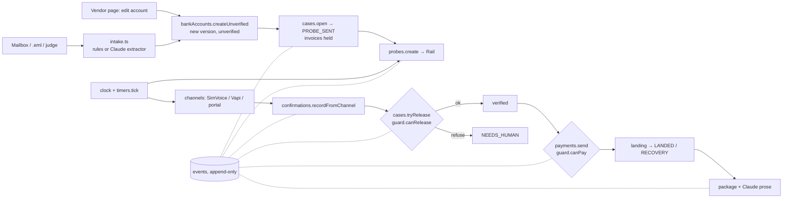

# TEAM_ONBOARDING.md — 15 minutes to productive

## What it is

Landed holds every vendor bank-account change until the vendor's contact of record reads back a randomized sub-dollar probe deposit. The payment function refuses any destination that is not verified for that vendor at the current account version, whatever the AI or a clerk did. After payment it checks the money landed; if not, it prepares the recovery package.

## Architecture (one picture)



## Where each concept lives (all under `web/convex/`)

| Concept | File | Notes |
|---|---|---|
| The gate (pure) | `guard.ts` | `canPay`, `canRelease`, transition table. Frozen. |
| Cases | `cases.ts` | open, transition, `tryRelease` (= markVerified), human actions. Frozen. |
| Probes | `probes.ts` | amount drawn here and never exposed; `getPublic` projects it away. Frozen. |
| Confirmations | `confirmations.ts` | channel acceptance (email → rejected). Frozen. |
| Payments | `payments.ts` | the only writer of `payments`; refusal returned, not thrown. Frozen. |
| Accounts / contacts | `bankAccounts.ts`, `contacts.ts` | versions; record/discovered/untrusted. Frozen. |
| Time | `clock.ts`, `timers.ts`, `crons.ts` | demo clock, `tick`, ACH windows. Frozen. |
| Audit | `events.ts` | append-only, redacted. Frozen. |
| Channels | `channels/` | `simVoice.ts`, `vapi.ts` (+ dry run), `portal.ts`, `initiate.ts` |
| Rails | `rails/` | `sim.ts`, `nessie.ts`, `select.ts` |
| Intake | `intake.ts` (Node), `extractors/rules.ts`, `extractors/claude.ts` |
| Package | `package.ts`, `packageTemplates.ts`, `packageProse.ts` |
| Judge mode | `judge.ts` + `scenarioData.json` (from `scripts/bundle-scenarios.py`) |
| Demo state | `seed.ts`, `seedDemo.ts`, `demoControls.ts`, `devTools.ts` |
| Extras | `explain.ts`, `exportCase.ts`, `nessieViewer.ts`, `discovery.ts`, `env.ts`, `timerQueries.ts` |
| HTTP | `http.ts` (`/eval/*` keyed, `/portal/*`, `/vapi/webhook`) |

Frontend: `web/app/*` pages import only `web/lib/hooks` and `web/components/landed/*`. All plain-English copy is in `web/lib/labels.ts` (+ `terms.ts`, `captions.ts`); `tests/labels.test.ts` fails if an enum has no label.

## Run locally

```bash
cd web && npx convex dev      # terminal 1 (local deployment in .env.local)
cd web && npm run dev         # terminal 2 → http://localhost:3000
cd web && node scripts/sync-env.mjs    # once: mirror keys from .env.local into the deployment
```
Settings → Re-seed fixtures gives the demo state (three demo cases + CleanCo's open invoice).

## Tests, eval, gate

```bash
cd web && npx vitest run                               # unit + invariants (convex-test, in-memory)
cd eval && .venv/bin/python runner.py --key $EVAL_KEY  # scenarios against the local deployment
bash scripts/verify.sh                                  # vitest + eval + next build; the gate for every commit
```
`EVAL_KEY` is in `web/.env.local`. The eval and judge mode re-seed the database; do not run them during a demo.

## Add a scenario

Copy any `eval/scenarios/*.yaml`, keep the step vocabulary (`inject`, `manual_edit`, `expect_case`, `advance_to`, `advance`, `vendor_statement`, `landing_statement`, `pay`, `expect_pay`, `craft_invoice`, `create_vendor`, `portal_confirm`, `mark_fraud`, `expect_package`), set `expect`, then `python3 scripts/bundle-scenarios.py` so `/judge` sees it. Run it: `runner.py --only <id>`.

## Add a page

`web/app/<route>/page.tsx` as a client component; data via a hook in `web/lib/hooks/index.ts`; new queries go in a NEW convex file (never in a frozen one); labels in `lib/labels.ts`; add to `components/landed/Shell.tsx` NAV if it needs a sidebar entry; run `npx tsc --noEmit && npx eslint app components lib && npx vitest run`.

## The three rules

1. **Frozen core.** The files marked Frozen above change only with a failing test first and a `core-fix:` commit.
2. **Additive.** New behavior = new file + flag or route. Public query shapes pages depend on do not change; add queries.
3. **Gate.** `scripts/verify.sh` green before every commit; red means revert, never edit an expectation.
